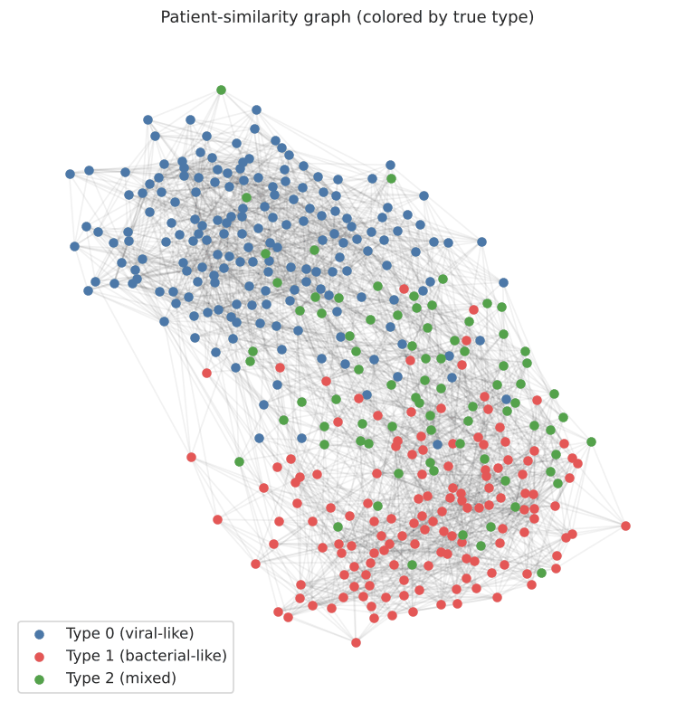
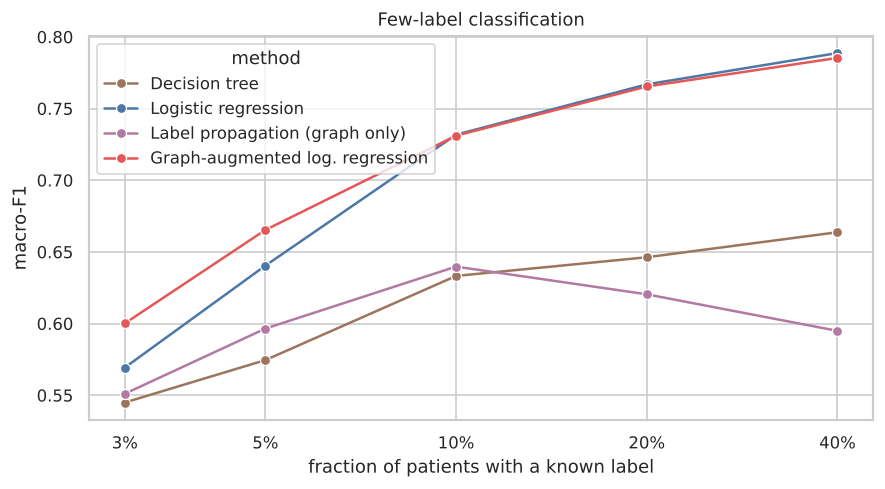
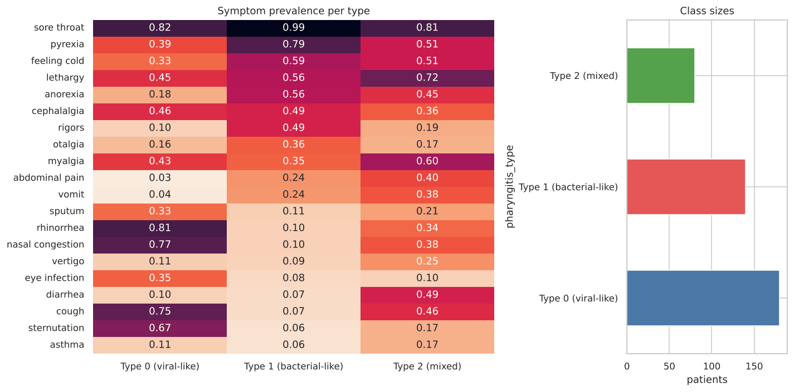
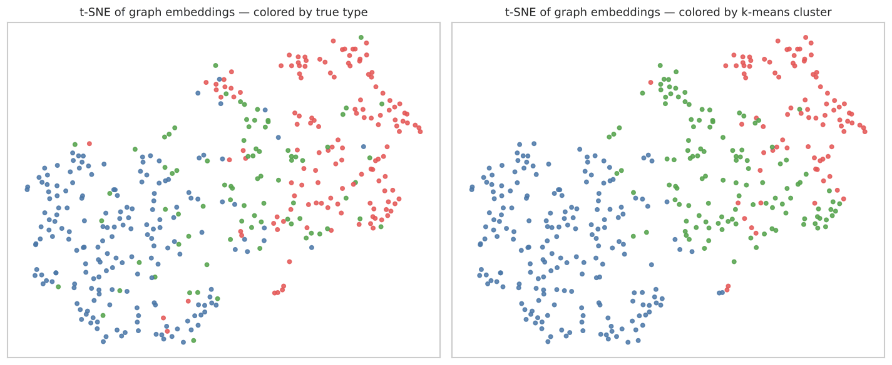
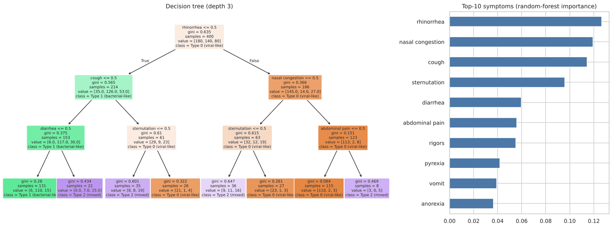

<div align="center">

# 🕸️ Patient-Similarity Graphs for Pharyngitis Classification

**Patients become nodes, shared symptoms become edges, and graph machine learning is used to group and classify them.**


[](https://colab.research.google.com/github/negarsh76/Patient-Similarity-Graph/blob/main/notebooks/patient_similarity_graph.ipynb)



</div>

---

## 💡 Idea

Each patient is described by **20 binary symptoms** (fever, cough, rhinorrhea, rigors…) and one of three pharyngitis types. Instead of treating patients as independent rows, we connect each one to its **10 most similar patients** by **Jaccard similarity** of their symptom sets. That turns the dataset into a graph, and graph methods can then exploit it.

| Step | Method |
|---|---|
| Baselines | Decision tree · random forest · logistic regression (5-fold CV) |
| Graph construction | Weighted k-NN graph on Jaccard similarity, edge homophily check |
| Unsupervised | Louvain communities · node2vec-style embeddings (random walks → PPMI → SVD) · k-means · t-SNE |
| Few-label learning | Label propagation · graph-augmented features (one SGC/GCN propagation step) |
| Evaluation | Accuracy, macro-F1, ARI, NMI, Hungarian-matched F1 |

## 📊 Results (synthetic data)

**Supervised baselines (5-fold CV):**

| Model | Accuracy | Macro-F1 |
|---|:-:|:-:|
| Decision tree (depth 4) | 0.732 | 0.644 |
| Random forest | 0.822 | 0.753 |
| **Logistic regression** | **0.860** | **0.825** |

**The graph is informative.** About 74 % of edges join two patients of the same type, against 37 % by chance.

**With few labels, adding the graph as context helps most where labels are scarcest:**



| Labelled | Decision tree | Logistic reg. | Label propagation | **Graph-augmented LR** |
|:-:|:-:|:-:|:-:|:-:|
| 3 % | 0.545 | 0.569 | 0.551 | **0.600** |
| 5 % | 0.575 | 0.640 | 0.596 | **0.665** |
| 10 % | 0.633 | 0.732 | 0.640 | 0.731 |
| 40 % | 0.664 | 0.789 | 0.595 | 0.785 |

The graph on its own (label propagation) is not enough. Used as **extra neighbourhood context**, it improves macro-F1 by about 3 points when only 3–5 % of diagnoses are known, then converges to plain logistic regression.

<table>
<tr><td></td><td></td></tr>
<tr><td align="center">Symptom prevalence per type</td><td align="center">Graph embeddings (t-SNE)</td></tr>
</table>



## ⚠️ About the data

`data/synthetic_patients.csv` is **fully synthetic**. It was generated by [`data/make_synthetic.py`](data/make_synthetic.py) from illustrative symptom prevalences, and it contains **no real patient records**. The original analysis used a private dataset, which is not shared here. Treat the numbers above as a demonstration of the method, not as clinical evidence.

## 🚀 Run

```bash
git clone https://github.com/negarsh76/Patient-Similarity-Graph.git
cd Patient-Similarity-Graph
pip install -r requirements.txt
python data/make_synthetic.py        # optional: regenerate the dataset
jupyter lab notebooks/patient_similarity_graph.ipynb
```

## 🔭 Next steps

- Full GCN / GAT models and learned graph construction
- Combining symptom graphs with throat-image features (see my [pharyngitis dataset paper](https://www.nature.com/articles/s41597-025-05780-5))
- Validation on de-identified real-world data

## 📄 License

MIT

---

<p align="center">Made by <a href="https://github.com/negarsh76">Negar Shojaei</a> · AI researcher in medical imaging</p>
